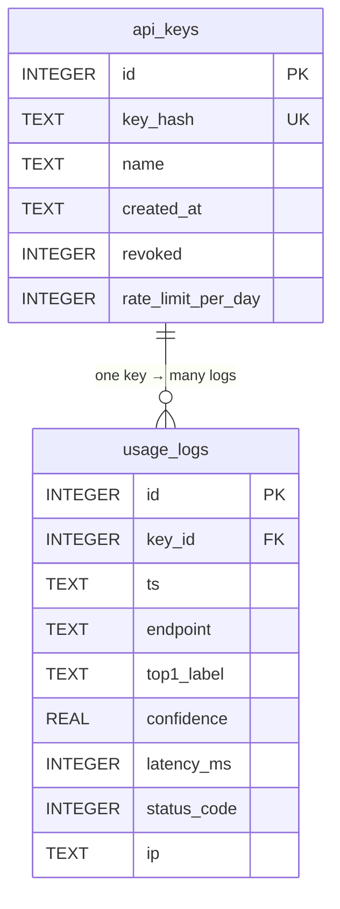

# Car Classifier — Database ERD (v1)

> Source of truth for tables is `docs/superpowers/specs/2026-10-07-car-classifier-design.md §6b`.
> SQLite v1 (`backend/data/keys.db`). Postgres migration keeps the same 3 auth functions.



## File stores (not tables)

- `models/index.faiss` — vectors (N, D), row i ↔ entry i in `index_meta.json`.
- `models/index_meta.json` — `{version, backbone, method, dim, entries[{row, class, view, source_path}]}`.
- `metadata.csv` — `{filepath, class, view, split, sha1, width, height, corrupt}` (see spec §5b).

## Post-v1 (Stripe phase, not built now)

```
users ||--o{ subscriptions : has
subscriptions ||--o{ api_keys : issues
```
Existing two tables unchanged; `api_keys` gains nullable `subscription_id FK`.
