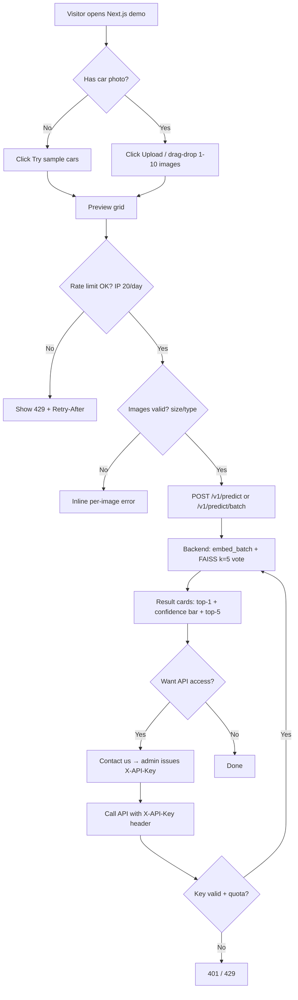

# Car Classifier — User Activity Flowchart (v1)

> Demo visitor (no login) + API caller (manual key). No Stripe/accounts in v1.

## Branches covered

1. Demo happy path: upload → results.
2. Sample path: no photo → bundled examples.
3. Guardrails: 400 corrupt, 413 too many/large, 429 rate-limited — all inline, batch returns per-item errors.
4. Conversion: demo → manual key → authenticated API (same classifier path).
